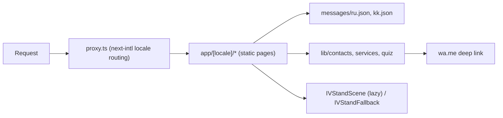

# NovaMed website

Bilingual (Russian / Kazakh) marketing site for NovaMed, an IV therapy clinic in Aktobe, Kazakhstan, where every booking path ends in WhatsApp.

## Why I built it

Built as client work for the clinic, which shares a building with the KDL Olymp diagnostic lab. The goal was a fast, accessible static site that sends a patient to a pre-filled WhatsApp chat in as few taps as possible. Pieces the client had not supplied yet (final logo vectors, prices, drip compositions, clinic photography) render honest fallbacks and are marked in-file; nothing is invented.

## Content and trademarks

This is a marketing site built for the clinic. The NovaMed name, logo, brand colours, copy, service descriptions and the contact details in `src/lib/contacts.ts` (clinic phone / WhatsApp, address, Instagram) belong to the clinic and appear here because they are already public on its channels. KDL Olymp is a separate company; its name is used only to describe the neighbouring lab. The MIT licence covers the source code only, not the clinic's branding or content, and does not grant any right to use them. The repository ships no photographs; `public/` is empty and the gallery renders a "photos coming" state until the clinic supplies images it has rights to.

## Features

- Russian at `/`, Kazakh at `/kz`; all copy in `messages/{ru,kk}.json` with identical keys.
- Seven page types (home, about, services, service detail, gallery, contacts, Olymp partner page), 16 statically prerendered pages.
- WhatsApp booking through one helper, `whatsappUrl(message)`, with pre-translated pre-filled messages.
- Service-picker quiz, FAQ, contact form, map link, sitemap, robots, hreflang.
- 3D IV-stand hero (react-three-fiber) as a progressive enhancement with an SVG fallback; loader skipped under `prefers-reduced-motion`.
- Colour contract enforced by a test: `npm run test:contrast`.

## Architecture



## Tech stack

Next.js 16 (App Router), React 19, TypeScript (strict), Tailwind CSS v4, next-intl 4, react-three-fiber + drei, anime.js 4, Lenis. Intended deploy target: Vercel.

## Quickstart

```bash
npm ci
cp .env.example .env.local   # set NEXT_PUBLIC_SITE_URL
npm run dev                  # http://localhost:3000
npm run build && npm start
```

Node 20+.

## Configuration

| Variable | Required | Purpose |
|---|---|---|
| `NEXT_PUBLIC_SITE_URL` | in production | Canonical origin (no trailing slash) for canonical, hreflang, sitemap, robots |

## Testing

```bash
npm run lint
npx tsc --noEmit
npm run test:contrast   # WCAG contrast pairings that must pass and must stay banned
npm run build
```

These four run in CI. There are no component or end-to-end tests. Earlier Lighthouse and axe-core results from the original build were run by hand and are not reproduced in CI.

## Project structure

```
src/
  app/[locale]/    route tree, one folder per page
  components/      brand, home, layout, motion, services, ui
  i18n/            routing and request config
  lib/             contacts, services, quiz, gallery, contrast test
  proxy.ts         locale middleware
messages/          ru.json, kk.json
```

## Status and limitations

- Production-shaped but pending client assets: logo vectors, cursive tagline, Olymp mark, prices, drip compositions and photography are placeholders.
- The Instagram block links out; it is not a live feed.
- The hero is react-three-fiber, not a hosted Spline scene.
- The contact form has no backend; it hands off to WhatsApp.

## Credits

Fonts: Unbounded and Golos Text (SIL OFL). Libraries as listed in `package.json`. KDL Olymp is the clinic's neighbouring lab.

## Licence

Code: MIT (see `LICENSE`). Clinic branding and content: see "Content and trademarks".

---

## Design notes

### The colour contract

`src/app/globals.css` opens with a measured contrast table and five rules.
**Read it before touching a colour.** The short version:

- Anything **filled** with a pillar colour uses `*-bg` with `--ink` text
  (4.56–7.37:1). Filling with `*-fg` and labelling it white lands at 3.02–4.49
  and fails AA, so that combination does not exist in the codebase.
- `*-fg` is an accent only: focus rings, borders ≥2px, icon strokes, liquid fills.
- Dark panels use `--ink`, never `--brand-teal`. Teal fails against both white
  (2.90) and ink (4.23), so it is a fill and scene colour only.
- **Never dim text with `opacity` on a coloured ground.** `ink` on
  `zolushka-bg` is 4.56 — six hundredths of headroom. At 90% it is 3.89 and
  fails. Hierarchy on those grounds comes from weight and size.

`npm run test:contrast` asserts all of it, including the combinations that must
stay *banned*. It fails the build loudly if a hex changes.

### The design

Grounded in what an infusion clinic actually is: fluid settling in a bag.

- **The meniscus** is the signature element. A real meniscus climbs the walls of
  its container, so the divider sits high at the edges and low across the middle.
  It appears four times only — hero into the mint pool, pool back to the page,
  into the safety section, into the footer. It never animates.
- The **hero IV stand** stands *in* the mint pool: the pool paints over the
  canvas so the base sits below the liquid line.
- **Pillar cards** hang at different heights, like bags on a stand, and take
  their proportion and corner radius from the logo card.
- The **hover fill** on a service card rises and stops below the text, because
  filling the whole card would break the contrast contract.
- The **walkthrough** is the only numbered sequence, and its bar segments are
  sized in proportion to real minutes, so the long stretch in the chair looks long.

Type: Unbounded (display) + Golos Text (body), both variable, both Cyrillic-native.

### Motion

One orchestrated moment — the loader — and restraint everywhere else.

`Loader.tsx` runs a five-beat anime.js timeline: the mark draws in via
`stroke-dashoffset`, NOVA reveals per character, the MED pill wipes in, a
droplet falls and spreads into a progress bar that waits on real asset loading
(capped at 900ms), then the ink screen and a mint/teal curtain split apart.

It is `sessionStorage`-gated (repeat visits get a 300ms fade), skippable by
click or Escape, and **not rendered at all** under `prefers-reduced-motion`.
It is a fixed overlay over an already-laid-out hero, so it never shifts layout.

Scroll reveals are pure CSS transitions with a stagger delay. anime.js is
dynamically imported and only reaches the browser for the loader and the quiz.

### The 3D hero

`IVStandScene.tsx` builds a real IV stand in react-three-fiber: pole, castor
base, cross bar, three pillar-coloured bags with liquid settled in the bottom,
drip chambers and lines. Hovering or selecting a bag swells it.

It is a **progressive enhancement**, gated in `useSceneUpgrade()` in `Hero.tsx`:

| condition | behaviour |
|---|---|
| `prefers-reduced-motion` | never loads — the value is the motion |
| fine pointer, ≥1024px | upgrades when the browser goes idle |
| everything else | upgrades on first touch of the scene |

Until then `IVStandFallback.tsx` renders the same stand as inline SVG at the
same size, so nothing shifts. three.js is ~231KB transferred and ~520ms of
script evaluation on a mid-range phone; this keeps that off the critical path.
Set `FORCE_SCENE_EVERYWHERE = true` in `Hero.tsx` to always upgrade at idle.

**The brief asked for a Spline scene.** Spline is a hosted visual editor that
needs an account and a manual publish step, so it cannot be produced from a
terminal. This is coded instead and lives behind one `<IVStandScene>` boundary —
dropping in a Spline embed later is a one-file swap.
